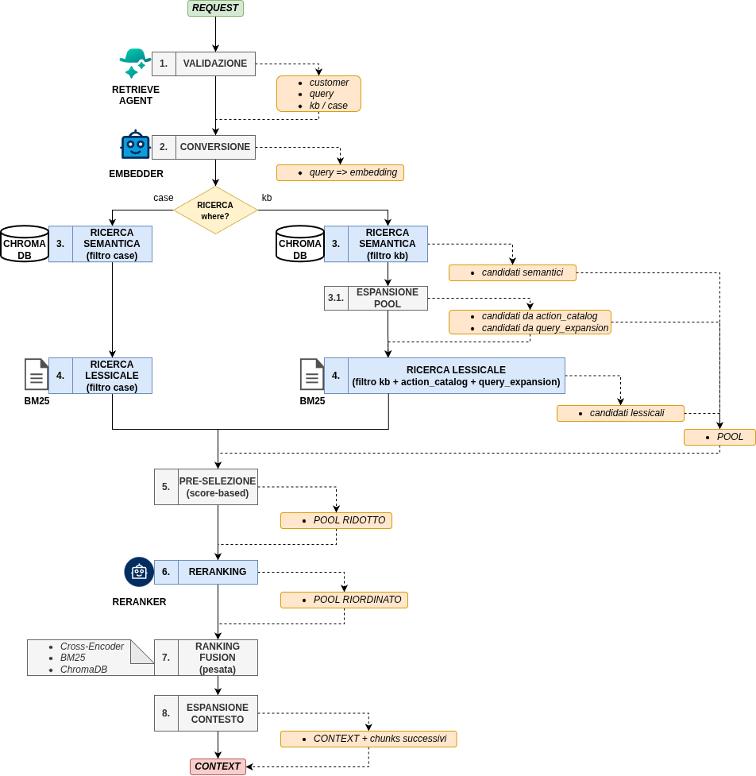

# RAG Service

Tramite API, viene chiamato un Retrieve Agent che recupera contesto utile partendo dall'alert in input, 
servendosi del RAG (Retrieve Augmented Generation). Il resto dell'infrastruttura (Triage, Action Planning, Contenimento) non è incluso nella seguente repo.

- [Terminale 1](#terminale-1)
  - [SSH keep alive](#ssh-keep-alive)
  - [Setup](#setup)
  - [Download datasets e avvio containers](#download-datasets-e-avvio-containers)
- [Terminale 2](#terminale-2)
  - [Popolare DB con datasets e indicizzare knowledge base](#popolare-db-con-datasets-e-indicizzare-knowledge-base)
  - [Invio alert e recupero del contesto](#invio-alert-e-recupero-del-contesto)

- [Valutazione e testing](#valutazione-e-testing)
- [Workflow schema](#workflow-schema)

## Terminale 1

### SSH keep alive
Se si utilizzano VM remote (es: Vast.ai) è consigliato:
```powershell
echo "
Host *
    ServerAliveInterval 30
    ServerAliveCountMax 6
    TCPKeepAlive yes
" > ~/.ssh/config
```

### Setup
```powershell
git clone https://github.com/floyddc/RAG-Service.git
cd RAG-Service
chmod +x *
pip install -r python/requirements.txt
echo "
RETRIEVAL_DIAGNOSTICS_ENABLED=true
TORCH_INDEX_URL=https://download.pytorch.org/whl/cu128
TORCH_SPEC=torch
RERANKER_DEVICE=cuda
HF_TOKEN=<TOKEN>
" > .env
```
- Così facendo, il Reranker girerà su GPU. Se non si dispone di GPU adeguata (min. 12gb di VRAM) rimuovere le righe riguardanti `TORCH_INDEX_URL`, `TORCH_SPEC` e `RERANKER_DEVICE`.

### Download datasets e avvio containers
```powershell
./fetch_datasets.sh
docker compose build
docker compose up
```
- Attendere che il servizio si avvii (`Application startup complete`) e restituisca `"GET /health HTTP/1.1" 200 OK`.

## Terminale 2

### Popolare DB con datasets e indicizzare knowledge base
```powershell
cd RAG-Service
./seed_DB.sh
./build_index.sh
```
- Prima di avviarsi, dovrebbe restituire `PostgreSQL online`.


### Invio alert e recupero del contesto

**Powershell:**
```powershell
$alert = Get-Content <ALERT_PATH> -Raw | ConvertFrom-Json
$body = @{
  customer = $alert.alert_customer_id
  alert = $alert
  k_cases = 0
  k_kb = 10
} | ConvertTo-Json -Depth 20 -Compress

$response = $body |
  curl.exe -sS -X POST http://localhost:8000/retrieve `
    -H "Content-Type: application/json" --data-binary "@-"

$results = $response | ConvertFrom-Json
$context = ($results | ForEach-Object { $_.text }) -join "`n`n"

$context
```

**Bash:**
```poweshell
file=<ALERT_PATH>
```
```bash
context=$(
  jq -n \
    --slurpfile alert "$file" \
    '{customer: $alert[0].alert_customer_id, alert: $alert[0], k_cases: 0, k_kb: 10}' |
  curl -sS -X POST http://localhost:8000/retrieve \
    -H "Content-Type: application/json" \
    --data-binary @- |
  jq -r 'map(.text) | join("\n\n")'
)

printf '%s\n' "$context"
```

## Valutazione e testing
Lo script chiama `POST /retrieve` (con knowledge base popolata e indicizzata) e calcola **hit@k, recall@k, precision@k, nDCG@k e MRR**, separatamente per case storici (`case`) e knowledge base (`kb`), utilizzando un dataset di sviluppo (da 88 query, di cui 8 sui cases e 80 sulla knowledge base) e un dataset di test (da 40 query sulla knowledge base).
```powershell
python3 -m evaluation.run_eval --seed-cases --output dev-report.json --diagnostics dev-trace.jsonl

python3 -m evaluation.run_eval --dataset evaluation/test_dataset.json --output test-report.json --diagnostics test-trace.jsonl
```


## Workflow schema
</img>